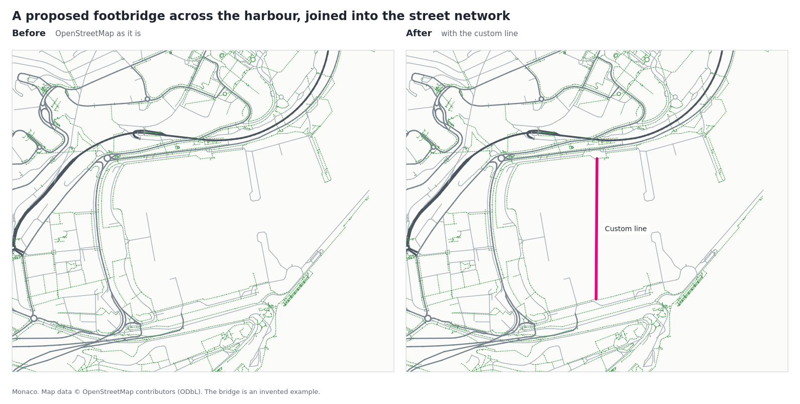

<p align="center">
  
</p>

<p align="center">
  <a href="https://plugins.qgis.org/plugins/networkforge_qgis/"></a>
  <a href="https://github.com/Yibbzz/networkforge-qgis/actions/workflows/tests.yml"></a>
  <a href="https://codecov.io/gh/Yibbzz/networkforge-qgis"></a>
  <a href="https://github.com/Yibbzz/networkforge-qgis/actions/workflows/network-analyst-latest.yml"></a>
</p>

# NetworkForge QGIS plugin

Add your own proposed roads, cycleways and paths to the OpenStreetMap
network, in QGIS. You get a **before** and an **after** network as OSM
PBF files for routers such as Valhalla, and as layers to look at.

It can also change or remove existing streets, ban turns, add bollards
and signals, add time-of-day traffic, and build a network from your own
lines alone.

Route on the result with routing.earth's
[Network Analyst plugin](https://github.com/routing-earth/network-analyst-qgis-plugin),
which runs Valhalla on your own computer, or with
[Easy-R5](https://github.com/GISBoost/easy-R5) for public transport.
Together they give QGIS a routable network of your own, for free.



## Install

In QGIS (3.34 or newer; Windows, macOS or Linux): **Plugins > Manage and
Install Plugins**, search for **NetworkForge**, **Install Plugin**.

The first time you run a tool, the plugin downloads its engine into a
`networkforge` folder in your QGIS profile (once, a few minutes, about
600 MB). Nothing is added to QGIS itself. `engine.log` in that folder
helps when reporting a problem.

## Start here

| | |
|---|---|
| [Tutorial](docs/tutorial.md) | A new bridge over the Thames at Reading, step by step, with routes before and after. Data included. |
| [Public transport tutorial](docs/tutorial-transit.md) | Esri's transit tutorial in QGIS with Easy-R5: Cincinnati's buses, reopened stairways and a new tram line. |
| [Traffic tutorial](docs/tutorial-traffic.md) | Rush hour in Bristol: how far a 15-minute drive reaches at 3 am and at 8 am. |
| [Examples](docs/examples.md) | Six short ones: a footbridge, a closed street, a one-way street, a banned turn, a bollard, a network of your own. |
| [Use cases](docs/use-cases.md) | Planning, floods and closures, traffic schemes, your own street data. |
| [Coming from ArcGIS](docs/migrating-from-arcgis.md) | Moving a street network to QGIS. |

## The tools

In the Processing Toolbox, under **NetworkForge**:

| Tool | What it does |
|---|---|
| **Build scenario network** | Joins your lines into OpenStreetMap for an area and writes the before and after networks. Downloads OpenStreetMap for areas up to 1,000 km2; bigger ones need a downloaded OSM file. |
| **Build standalone network** | A network from your own lines alone. |
| **Add traffic (time of day)** | Slower streets at busy times, for Valhalla: by road class, for single streets, or from a table of measured speeds. Routes with a departure time use it. |
| **Check custom network layer** | Checks your lines and attributes in seconds, without downloading anything. |
| **Engine information** | The installed engine's version; can reinstall it. |

## Your lines

Your lines are an ordinary line layer in a GeoPackage (not a Shapefile,
which shortens field names). Describe each one with OpenStreetMap's
field names, such as `highway`, `maxspeed` and `oneway`, or pick a
preset for all of them. The same layer can change or remove existing
streets and ban turns; a points layer adds bollards, signals and
crossings.

The engine's **[network rules](https://github.com/Yibbzz/networkforge/blob/v1.4.0/docs/network-rules.md)**
say what each field means and where lines join. When a line is wrong,
the tool selects it and links to the rule that explains why.

## Limits

- No public transport of its own (Easy-R5 adds it from GTFS timetables)
  and no traffic simulation: "Add traffic" takes the speeds you give it.
- Turn restrictions, bollards and signals are in the PBF files, and
  routers obey them. The layers show them, but QGIS's own network tools
  ignore them.
- R5 ignores barriers too, and reads a cycle track only when it is drawn
  as a line of its own.
- An existing street can be changed or removed, not redrawn.
- Areas the size of a county need a lot of memory.

## How it is tested

Every kind of change is built with this plugin and then routed on with
the Network Analyst plugin's own tools
([`tests/test_network_analyst.py`](tests/test_network_analyst.py)), on
QGIS 3 and 4, on Linux, Windows and macOS, and weekly against the newest
version of their plugin. Public transport is tested the same way with
Easy-R5 ([`tests/test_easy_r5.py`](tests/test_easy_r5.py)).

## Development

All the network logic lives in the engine,
[NetworkForge](https://github.com/Yibbzz/networkforge), which the plugin
runs as a separate program. This repository is the QGIS front end.

```sh
# Link the plugin into your QGIS profile (reload it with Plugin Reloader)
ln -s "$PWD/networkforge_qgis" ~/.local/share/QGIS/QGIS3/profiles/default/python/plugins/

# Tests, with QGIS's Python
uv venv --python /usr/bin/python3 --system-site-packages .venv
uv pip install --python .venv/bin/python -r requirements-dev.txt
QT_QPA_PLATFORM=offscreen .venv/bin/python -m pytest
```

The first test run downloads the engine, the Network Analyst plugin,
Valhalla, Easy-R5 and Java into `.pytest_cache` (needs the internet and
port 8002). `-m "not engine and not network_analyst and not easy_r5"`
runs only the fast tests. [`manual-test/`](manual-test/README.md) is a
checklist for what automated tests can't see.

Pushing a version tag builds the zip and publishes it, after the checks
plugins.qgis.org runs on an upload (`scripts/plugin_checks.sh`).

## Licence

[GPL-3.0](LICENSE). Map data © OpenStreetMap contributors, under the
[Open Database License](https://www.openstreetmap.org/copyright).
