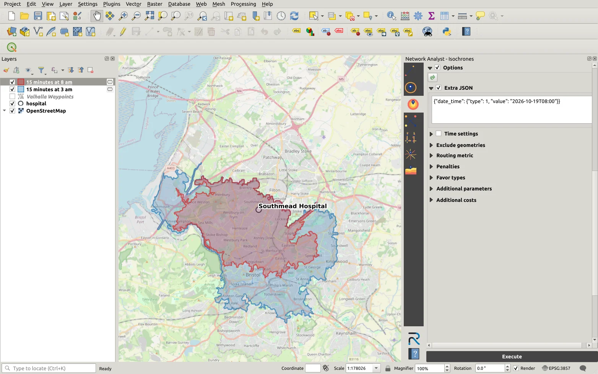
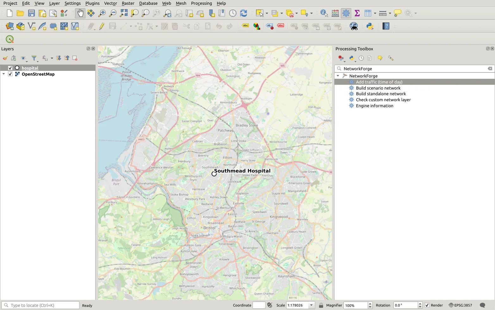
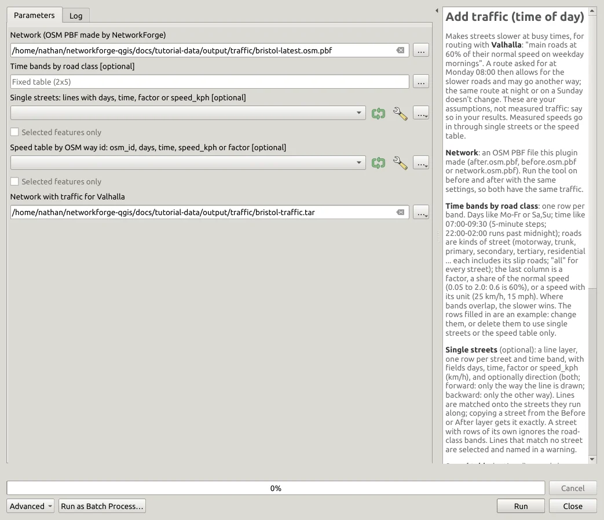
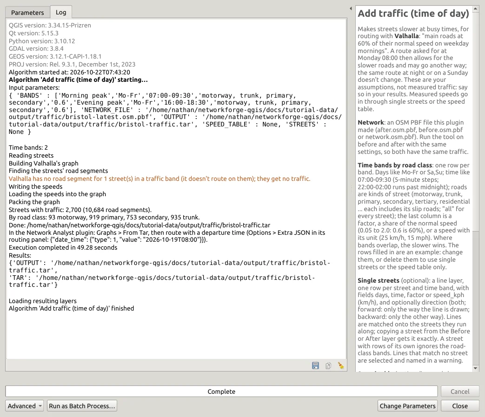
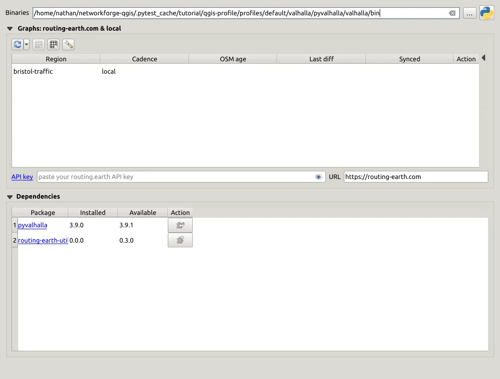
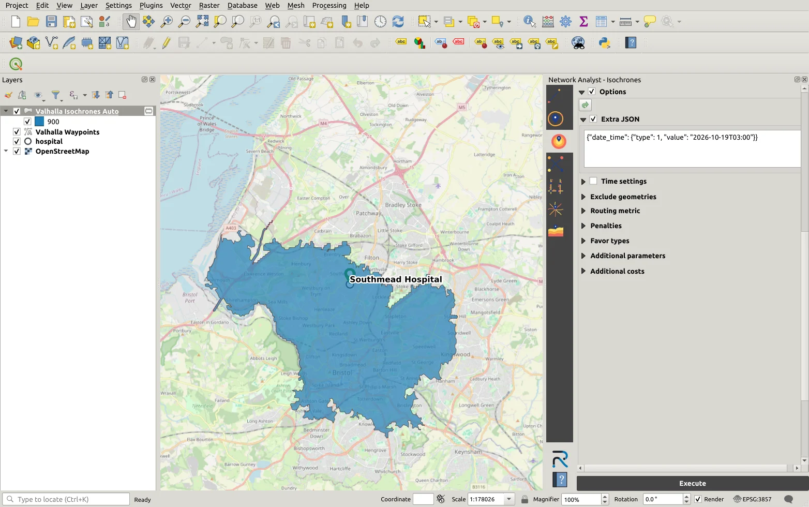
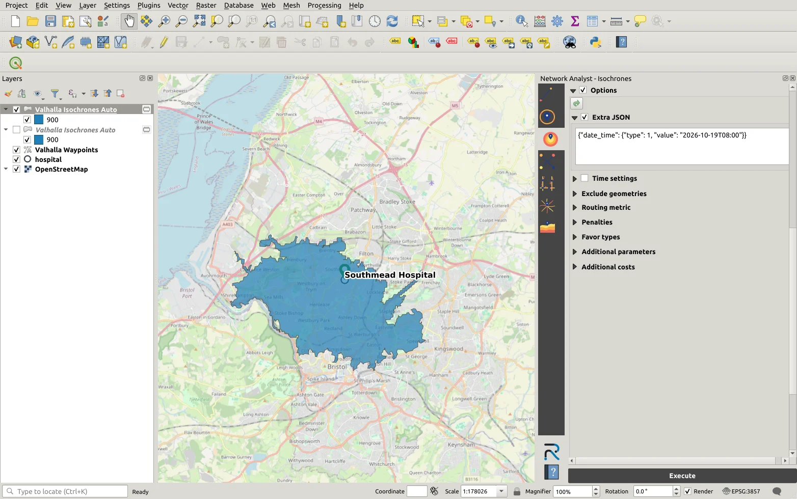

# Traffic in QGIS: how far can you drive at rush hour?

This tutorial will show you how to add traffic to a street network and how you can see the difference it makes. We'll be looking at isochrones in the Network Analyst plugin to demonstrate this change; and you don't need any pre-made traffic data.

**Problem:** How far can you drive from Southmead Hospital in Bristol in 15 minutes at 3 am, when traffic is at its lowest? And how far can you get at 8 am (rush hour)? What does the difference look like?



| | |
| --- | --- |
| **You will make** | A street network of Bristol with rush hour traffic in it as a routing graph for Valhalla |
| **You will find out** | How much smaller a 15-minute drive area gets in rush hour |
| **You need** | QGIS 3.34 or newer and an internet connection |
| **You don't need** | Any traffic data, a license, an account or a server |
| **Tools** | The **NetworkForge** and **Network Analyst** QGIS plugins |

> The traffic in this tutorial is purely assumption, not based on real measurements. The assumption is that main roads run at 60% of their normal speed during rush hour (8 am). The streets are real though as they come from OpenStreetMap (map data ©
> OpenStreetMap contributors, ODbL).

**Contents**

1. [What you need](#1-what-you-need)
2. [Add the traffic](#2-add-the-traffic)
3. [Load it into the Network Analyst plugin](#3-load-it-into-the-network-analyst-plugin)
4. [Isochrones at 3 am and at 8 am](#4-isochrones-at-3-am-and-at-8-am)
5. [What you found](#5-what-you-found)
6. [Going further](#6-going-further)

* * *

## 1. What you need

You will need the NetworkForge plugin and the Network Analyst plugin with pyvalhalla installed to do this analysis. If you haven't installed them yet, [the first tutorial](tutorial.md#1-get-the-plugins-and-the-data) shows you how.

Then download two files:

- The streets (all roads) of Bristol from Geofabrik: [bristol-latest.osm.pbf](https://download.geofabrik.de/europe/united-kingdom/england/bristol-latest.osm.pbf) (~13 MB).
- The hospital: [bristol-traffic.gpkg](tutorial-data/bristol-traffic.gpkg) (file in the same folder as this tutorial). Drag it onto the map with an **OpenStreetMap** background from **XYZ Tiles** in the **Browser** panel.

Open **Processing > Toolbox** and type `NetworkForge` in the search box. The tool we'll use is called **Add traffic (time of day)**:



## 2. Add the traffic

Open **Add traffic (time of day)** and fill it in:

| Setting | Value |
| --- | --- |
| **Network** | `bristol-latest.osm.pbf` |
| **Time bands by road class** | Leave the two example rows as they are |
| **Network with traffic for Valhalla** | `bristol-traffic.tar` in your own folder |



So there are three ways you can add traffic into a network - time bands by road class, single streets or a speed table with the feature IDs you want to apply that speed to. The default will be what's in the **Time bands by road class** input, which is a Fixed table (2x5). If you select the ... button next to it, you can see the defaults - motorways, trunk, primary and secondary roads at 0.6 (60% of their normal speeds) on weekdays from 07:00 to 09:30 and 16:00 to 18:30. You can change all of it, for example instead of `0.6` you can also type a set speed such as `25 km/h` and if you don't want it applied and want to use one of the other methods you can delete them all with **remove all**.

Click **Run** -



The log will tell you how many and what streets got traffic. It's ok if there's a warning about a street Valhalla doesn't route on (a private road for example), it just means that street can't get any traffic.

The result is a .tar file, which is Valhalla's routing graph of Bristol with the rush hour speeds in it.

## 3. Load it into the Network Analyst plugin

1. Open the Network Analyst plugin's settings
2. In the **Graphs** box click the small arrow next to the first refresh circle button and choose **From Tar**.
3. Pick `bristol-traffic.tar`. The plugin moves the file into its own library (it doesn't copy it) and names the graph after it.



## 4. Isochrones at 3 am and at 8 am

An isochrone is an area (polygon) you can reach within a certain time. In the Network Analyst panel -

1. **Provider**: `localhost`. **Local Server**: `bristol-traffic` then click the start button.
2. Select the **Isochrones** icon (the third one down on the left) and the car **Profile**.
3. **Waypoints**: click the green **+** and click on the hospital, or add from layer - hospital.
4. Type `900` for the intervals (15 minutes in seconds).
5. Tick the **Options** box, **Extra JSON** and paste in the time you're leaving. This is Monday 19 October 2026 at 3 am (`type` 1 means "depart at"):

   ```json
   {"date_time": {"type": 1, "value": "2026-10-19T03:00"}}
   ```
6. Click **Execute**.



That's how far you can get at 3 am. Now change the time in the JSON to `08:00` and select **Execute** again:



It's now a lot smaller! To see them together, rename the two layers in the **Layers** panel (right-click - **Rename Layer**) and give each its own colour like the picture at the start of the tutorial.

## 5. What you found

| 15 minutes' drive from Southmead Hospital | Area |
| --- | --- |
| Monday 3 am | about 81 km2 |
| Monday 8 am | about 44 km2 |

That's nearly a 50% reduction during rush hour! You can work the areas out yourself with the **Field Calculator** on each layer using `$area / 1000000`.

## 6. Going further

- **Single streets**: if you know one street is slow (a queue at a bridge etc.) you can draw it or copy it from a network layer into a line layer with `days`, `time` and a `factor` or `speed_kph`, and input the layer to the tool in **Single Streets**
- **Measured speeds**: if you already have speeds by OpenStreetMap way, like from a survey or a traffic data company you can put them in a table with `osm_id`, `days`, `time` and `speed_kph`, and give it to the tool as the **Speed table**. A CSV added to QGIS does the job.

The engine's [traffic guide](https://github.com/Yibbzz/networkforge/blob/v1.3.0/docs/traffic.md) explains every single setting if you want to know more.

Some things to bear in mind:

- The traffic is what you assume or measure. **It does not model congestion**, so a new road will not attract traffic and get slower.
- Only the Network Analyst panel's routes and isochrone tools consider traffic, and only when you input a time.
- Valhalla stores a week of speeds in a compact way, so the start and end of a band fade over about 40 minutes. Bands of two hours or more work best.
