# Public transport in QGIS: how far can you get by bus in 30 minutes?

This tutorial will show you how to build new and modify existing streets and bus timetables together into one network. It will answer a couple planning questions and prove the builds are valid by doing some simple routing, showing how far you can get from downtown in 30 minutes, at rush hour and in the middle of the afternoon.

We're going to look at three problems:

**Problem 1:** Downtown Cincinnati is served by two bus companies:
Metro on the Ohio side of the river and TANK on the Kentucky side. How
far can you get from Fountain Square in 30 minutes by bus, streetcar
and on foot leaving at 5:15 pm? And leaving at 2:00 pm, when buses run
less often?

**Problem 2:** Klotter Avenue sits on the hill above Brighton, about 150 m
from the busy bus stops on Central Parkway. Two old public stairways
used to lead down there but both are now closed! So the walk to the bus now takes quite a while. How much more of the city could the people living
there reach in 30 minutes if the city reopened them?

**Problem 3:** Cincinnati has talked about taking its streetcar up the
hill to Uptown and the University since 2007. What would a tram up Vine
Street add to the afternoon service area from
Fountain Square?

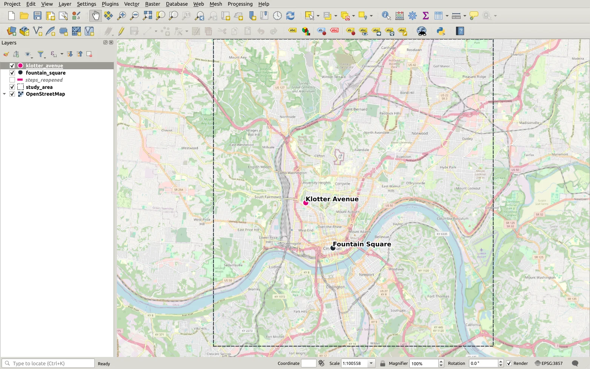

| | |
| --- | --- |
| **You will make** | A street network of Cincinnati, Covington and Newport before and after reopening the stairways and a transit network of it with both bus companies' timetables |
| **You will find out** | How far 30 minutes gets you from downtown at 5:15 pm and at 2:00 pm and how much two stairways change it for the people on the hill and what a new tram line adds |
| **You need** | QGIS 3.34 or newer (but not QGIS 4: Easy-R5 doesn't run there yet), 4 GB of free memory (ram) and an internet connection |
| **You don't need** | A license, an account, a server, Java or R5 installed beforehand |
| **Tools** | The **NetworkForge** and **Easy-R5** QGIS plugins |

> The stairways are real and really closed in OpenStreetMap. Reopening
> them is the tutorial's idea not a city plan. The streets come from
> OpenStreetMap (map data © OpenStreetMap contributors, ODbL) and the
> timetables from Metro and TANK. Timetables change every few months,
> so your numbers will differ a little from the ones here, which are
> for Tuesday 20 October 2026.

**Contents**

1.  [Get the plugins and the data](#1-get-the-plugins-and-the-data)
2.  [Look at the timetables](#2-look-at-the-timetables)
3.  [Build the street network](#3-build-the-street-network)
4.  [Build the transit network](#4-build-the-transit-network)
5.  [The service area at 5:15 pm](#5-the-service-area-at-515-pm)
6.  [The service area at 2:00 pm](#6-the-service-area-at-200-pm)
7.  [Reopen the stairways](#7-reopen-the-stairways)
8.  [Add a tram line](#8-add-a-tram-line)
9.  [What you found](#9-what-you-found)

* * *

## 1. Get the plugins and the data

### NetworkForge

1.  In QGIS, open **Plugins > Manage and Install Plugins > Settings**.

2.  Tick **Show also Experimental Plugins**.

3.  Under **Plugin Repositories** click **Add**, name it `NetworkForge`,
    paste this URL and click **OK**:

    ```
    https://github.com/Yibbzz/networkforge-qgis/releases/latest/download/plugins.xml
    ```

4.  On the **All** tab, search for **NetworkForge** and click
    **Install Plugin**.

### Easy-R5

[Easy-R5](https://github.com/GISBoost/easy-R5) by GISBoost runs
Conveyal's R5 <https://github.com/conveyal/r5>, the routing engine behind Conveyal Analysis and the r5r
and r5py packages, from QGIS. R5 is built for public transport as it
reads timetables in the GTFS format that almost every transit company
publishes.

1.  In **Plugins > Manage and Install Plugins**, search the **All** tab
    for **Easy-R5** and install it (it is experimental too so the box
    you ticked above must stay ticked).
2.  Open **Processing > Toolbox**, type `R5` in its search box, and
    double-click **Download R5 engine and Java 21** (under **Setup**).
    Click **Run**. It downloads R5 and a Java of its own, about 240 MB,
    into a folder in your home folder. Again this'll only happen once.

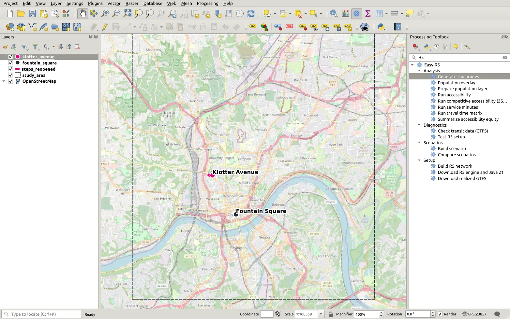

### The timetables

You can download the two companies' GTFS feeds into a new folder of their own `cincinnati-gtfs` and give them short names -

| Save as | Company | Download |
| --- | --- | --- |
| `metro.zip` | Metro (Southwest Ohio Regional Transit Authority) buses and the streetcar | https://www.go-metro.com/uploads/GTFS/google_transit_info.zip |
| `tank.zip` | TANK (Transit Authority of Northern Kentucky) | https://tank.rideralerts.com/InfoPoint/GTFS-Zip.ashx |

Keep them as `.zip` files as R5 reads them as they are.

> For another city, the [Mobility Database](https://mobilitydatabase.org)
> lists the GTFS feeds of transit companies around the world.

### The tutorial's layers

[cincinnati-transit.gpkg](tutorial-data/cincinnati-transit.gpkg) holds:

| Layer | What it is |
| --- | --- |
| `study_area` | The polygon that has the area covering where you need network data. This is about 240 km2 covering downtown, Covington and Newport across the river and the hills to the north |
| `fountain_square` | The start of problem 1 |
| `klotter_avenue` | The start of problem 2: a home on Klotter Avenue |
| `steps_reopened` | The two closed stairways as changes that reopen them (step 7) |

Start a new project, add **XYZ Tiles > OpenStreetMap** from the
**Browser** panel as a background, and drag the GeoPackage onto the map
and you should now see all four layers.

## 2. Look at the timetables

Now you need to check the GTFS files you've just downloaded to make sure each stop is valid - i.e. has a time, calendar files and which days it covers. Luckily there's a tool that can do this for you in Easy-R5.

In the Processing Toolbox, open **Check transit data (GTFS)** (under
**Diagnostics**):

| Setting | Value |
| --- | --- |
| **GTFS .zip file** | `metro.zip` |
| **Check every .zip in that folder** | Ticked. It will check both feeds together, as R5 will read them |
| **Analysis date to check** | A weekday, written `2026-10-20` (see below) |
| **Study area / OSM extent** | Click the button at the right, **Calculate from Layer**, `study_area` |
| **Report (HTML)** | A file of your own, e.g. `gtfs-report.html` |

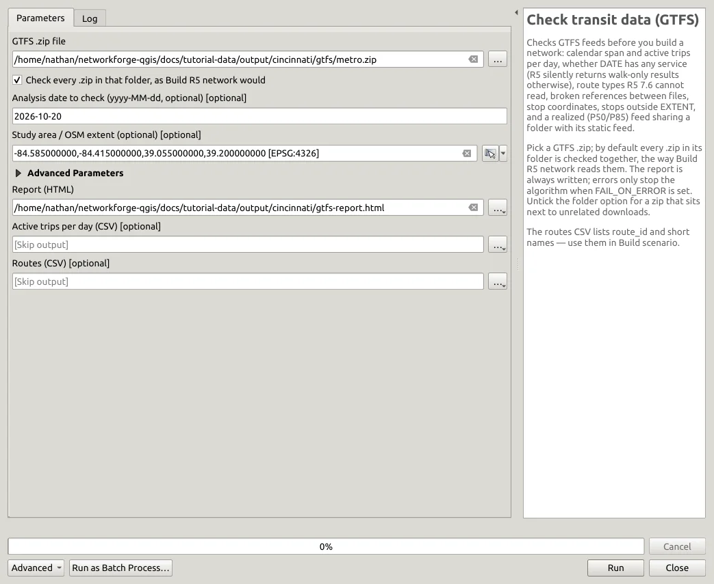

Click **Run**, then open the report in your web browser.

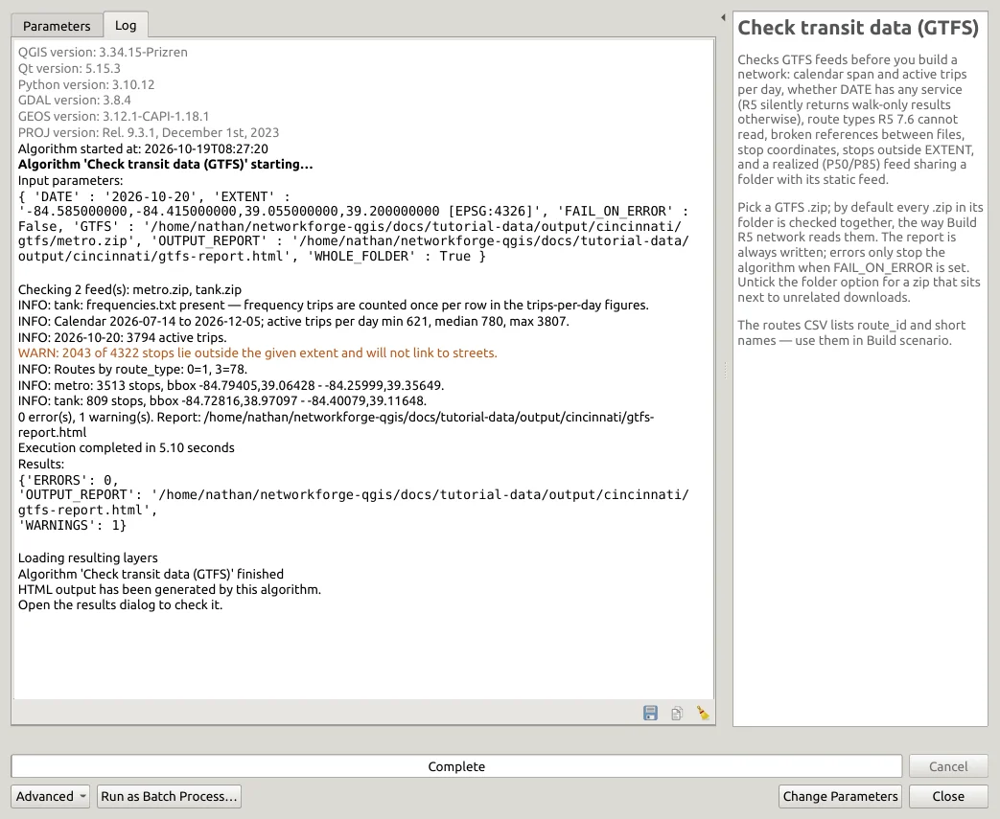

What it found for these feeds in the logs-

- **No errors-** Nothing that would stop R5 from reading them.
- **One warning-** around half the stops lie outside the study area.
    That's expected as both companies run far into the suburbs, and only
    the stops inside the area can be reached. If a stop you care about
    is outside you'll make the study area bigger to cover it.
- **The calendar-** The report lists the number of trips on every day
    the feeds cover. Weekdays from 5 October to 6 November 2026 have
    about 3,800 trips. Before that only TANK's timetable is valid
    (about 780 trips a day), after it only Metro's (about 3,000).

That last point is important and it's why you have to choose the date with care. To compare a transit
analysis, you need to look at a particular day and R5 will quietly fall back to walking
if nothing runs that day. Therefore you need to pick a **day where both feeds run,** in this case we've picked the
one with the most trips in the report. This tutorial uses Tuesday
20 October 2026. Your feeds will probably be newer, so pick a weekday from your
own report and use it everywhere this tutorial says `2026-10-20`.

## 3. Build the street network

A transit network needs streets as well to walk to the first stop,
between stops when changing buses, and from the last stop to where you
are going. R5 reads them from an OpenStreetMap PBF file and making that
file is NetworkForge's job.

You can build this PBF file with the Build scenario tool in the processing toolbox, which will output a before and after network (one without your modifications and another with them):

| Setting | Value |
| --- | --- |
| **Area** | **Calculate from Layer**, `study_area` |
| **Custom network layer** | `steps_reopened` |
| **Travel type** | **Use each feature's own attributes** |
| **Output folder** | A new, empty folder of your own |

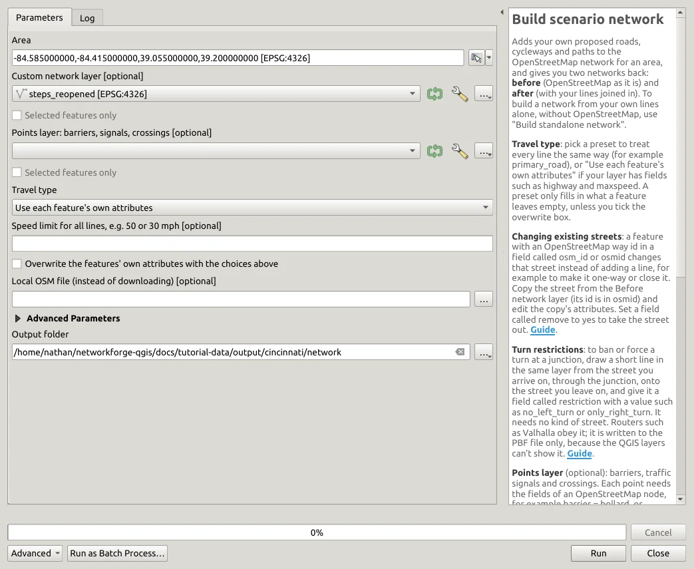

Now click **Run** and the tool will download the streets of the area from
OpenStreetMap (it takes about 8 minutes and 4 GB of memory: 240 km2 of
a city with every sidewalk mapped is a lot of streets), applies the
changes, and writes `before.osm.pbf` and `after.osm.pbf` into the
folder, with the **Before network** and **After network** layers as a
preview in QGIS. Step 7 explains the changes.

> If you only wanted today's network, any OpenStreetMap PBF that covers
> the area would do, for instance one from
> [Geofabrik](https://download.geofabrik.de) or
> [BBBike](https://extract.bbbike.org). NetworkForge is useful
> when you want to change something, as in step 7.

## 4. Build the transit network

Now this becomes quite simple with Easy-R5, the **Build R5 network** tool reads the GTFS feeds, links each stop to its nearest walkable street and routes you along the streets between stops when you change buses.

Open **Build R5 network** (under **Setup**):

| Setting | Value |
| --- | --- |
| **OSM extract (.osm.pbf)** | `before.osm.pbf` from step 3 |
| **Folder of GTFS feeds** | Your `cincinnati-gtfs` folder |
| **Network cache folder** | Leave empty |

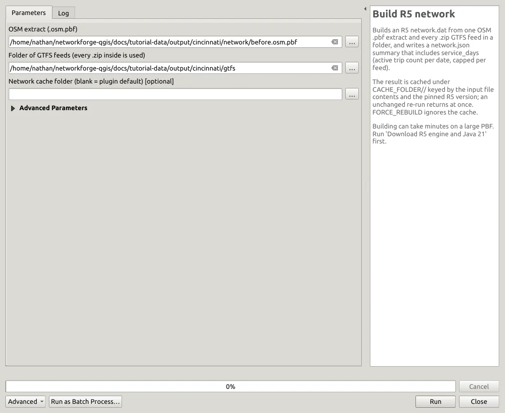

Click **Run**. It takes under a minute and the log ends with a summary (two
feeds, 4,322 stops, 79 routes, and the days with service) and, under
**Results**, the path of the network it built: a file called
`network.dat`, in a `networks` folder next to R5.

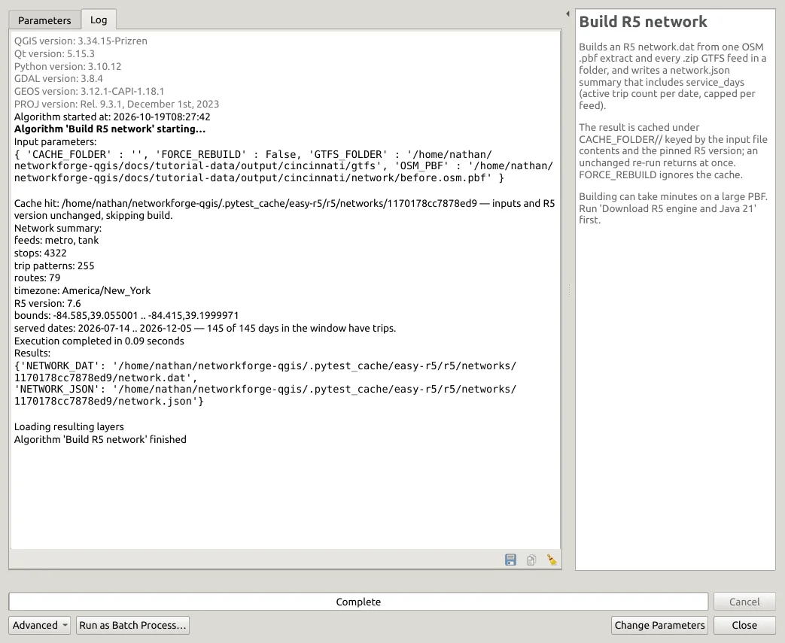

Make sure to copy that path as the next tool will need it. Then do the same with
`after.osm.pbf`, for step 7. Each PBF gets a `network.dat` of its own,
in a folder of its own, so note which is which.

Who may walk where comes from OpenStreetMap, R5 keeps pedestrians off motorways and off anything tagged
`foot=no`.

## 5. The service area at 5:15 pm

Open **Generate isochrones** (under **Analysis**). An isochrone is the same as a service area - everywhere you can get to within a
certain time.

| Setting | Value | Why |
| --- | --- | --- |
| **R5 network (network.dat)** | The `network.dat` of `before.osm.pbf` | |
| **Origin points** | `fountain_square` | |
| **Origin id field** | `name` | |
| **Date** | `2026-10-20` | Your weekday from step 2 |
| **Departure time** | `17:15` | |
| **Departure window (minutes)** | `1` | Leave at exactly 5:15 pm |
| **Max trip duration (minutes)** | `30` | |
| **Travel mode** | `TRANSIT + WALK` | |
| **Cutoffs** | `30` | |
| **Grid spacing (metres)** | `100` | Finer than the default 250 m, for a sharper outline |
| **Output isochrones** | A file of your own, e.g. `peak.gpkg` | |

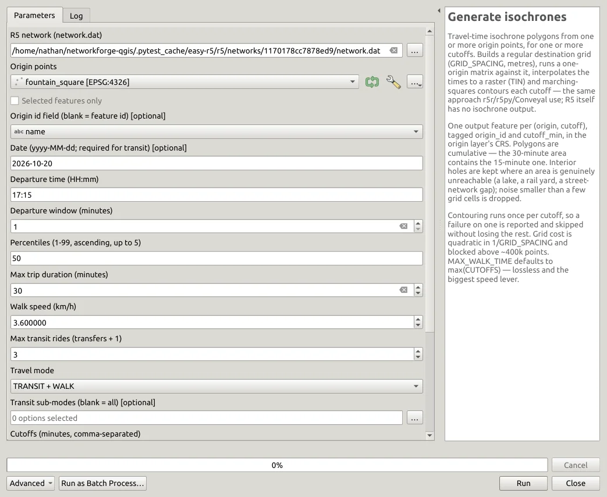

Click **Run,** and R5 works out the quickest trip from Fountain Square to
points 100 m apart all over the area, walking and riding, waiting at
stops for the next bus by the timetable, and Easy-R5 draws the line
round everything within 30 minutes:

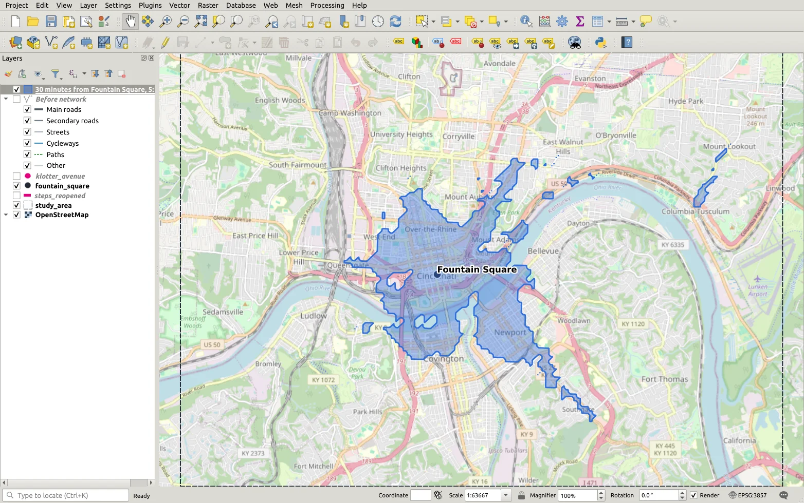

The area amounts to **11.7** **km2.** It reaches out along the bus
lines, and there are small islands round stops further out which look strange but they're actually places you
can reach by getting off a bus and walking a little, without the land
in between being within 30 minutes. It also crosses the river to Covington
and Newport, where TANK services take over.

> **The departure window.** Easy-R5's default window is 120 minutes: it
> works out the trip for every minute from the departure time onwards
> and gives the middle value (the 50th percentile). That answers
> "how far do I usually get, whenever I leave" rather than "how far
> do I get if I leave at exactly 5:15", it smooths out the luck of just
> catching or missing a bus.

## 6. The service area at 2:00 pm

Run **Generate isochrones** again with the same settings, except
**Departure time** `14:00` and a new output file:

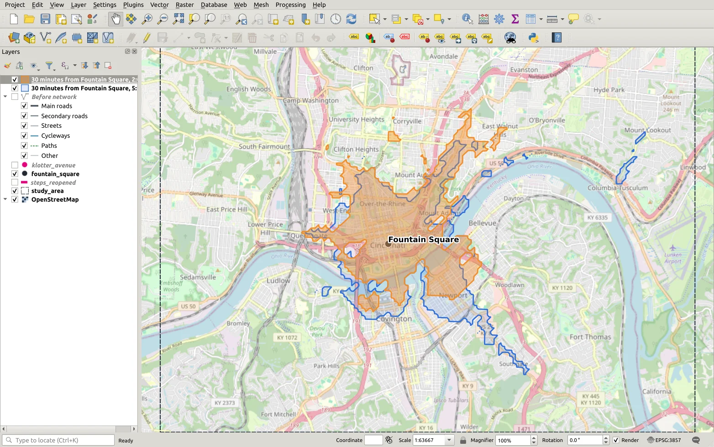

The area has visibly changed to **10.5** **km2** at 2:00 pm (orange), against 11.7 km2 at 5:15 pm (blue).
It's because in the afternoon buses run less often so more of the 30 minutes goes
on waiting...

## 7. Reopen the stairways!

### The problem

Cincinnati is very hilly and as a result there are many walking routes going up them that help cut journey times. But many have been closed. Two of
them climb from West McMicken Avenue, by the bus stops on Central
Parkway at Brighton, up towards Klotter Avenue. In OpenStreetMap both
are tagged `foot=no`, so no router will send anyone up or down them.

Add the **Before network** layer from step 3 if it isn't on the map,
and zoom to Brighton. The two stairways are drawn in pink:

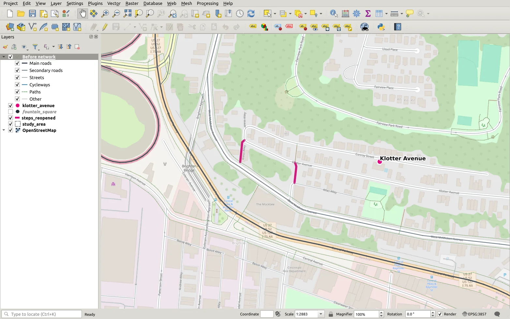

### Reopening them

The `steps_reopened` layer changes the two stairways, if you open its attribute table you can see how -

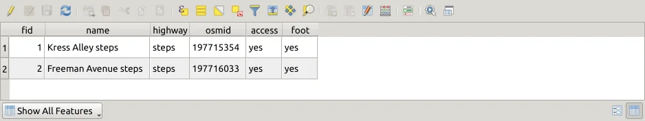

| Field | Value | What it says |
| --- | --- | --- |
| `osmid` | `197716033`, `197715354` | Which OpenStreetMap way to change: the Freeman Avenue and Kress Alley steps |
| `foot`, `access` | `yes` | Open to people on foot (OpenStreetMap had `no` in both) |
| `highway` | `steps` | Unchanged: they're still stairs |

To make such a change yourself you can select the street in the **Before
network** layer, copy it into a layer of your own (**Edit > Copy
Features**, then **Edit > Paste Features**), and fill in only the
attributes that should be different. Its OpenStreetMap way id will come
with it in `osmid`.

You already built the network with these changes in step 3, and built
`after.osm.pbf` into an R5 network in step 4. So you should now see the **After network**
layer will have two stairways that are drawn in orange as changed.

### The result

Run **Generate isochrones** twice more, with **Origin points**
`klotter_avenue` and **Departure time** `17:15`: once on the `network.dat`
of `before.osm.pbf`, once on that of `after.osm.pbf`.

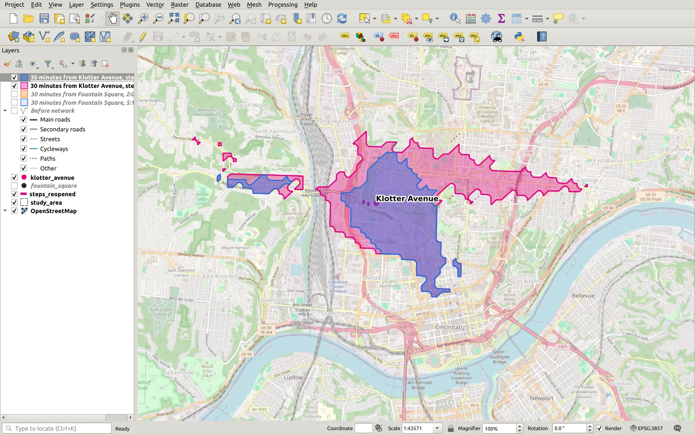

With the stairways closed, 30 minutes from Klotter Avenue only covers
**3.0 km2 -** Clifton Heights and Over-the-Rhine, mostly on foot or by a
slow way round to a bus. When reopened, it covers **5.9 km2**, nearly twice
as much! The buses on Central Parkway are now a few minutes' walk away,
and they reach the University of Cincinnati, Corryville and on east to
Walnut Hills.

Two short stairways, about 40 m and 36 m long, double the city that the
people on the hill can reach. That is the kind of question a transit
network you can change answers, and the reason to build it.

## 8. Add a tram line

### Changing the public transport, not the streets

We changed the streets in step 7, but what if you want to change the public transport network? With Easy-R5, you can make these changes to the timetables using the **Build Scenario** tool -

| Change | How |
| --- | --- |
| Add a new line | Draw it as a line in QGIS, with each vertex being a stop. Give it a speed, how often it runs (the headway) and its hours |
| Remove a route | Its name, e.g. `33` |
| Make routes faster or slower | Their names and a factor: `1.25` is 25% faster |
| Run routes more or less often | Their names and a new headway in minutes |

### The line

The `uptown_tram` layer is the tram: one line up Vine Street from
Fountain Square, through Over-the-Rhine, up the hill to Clifton Heights
and Corryville, ending at Martin Luther King Drive by the University.
You can see its eight vertices are its eight stops:

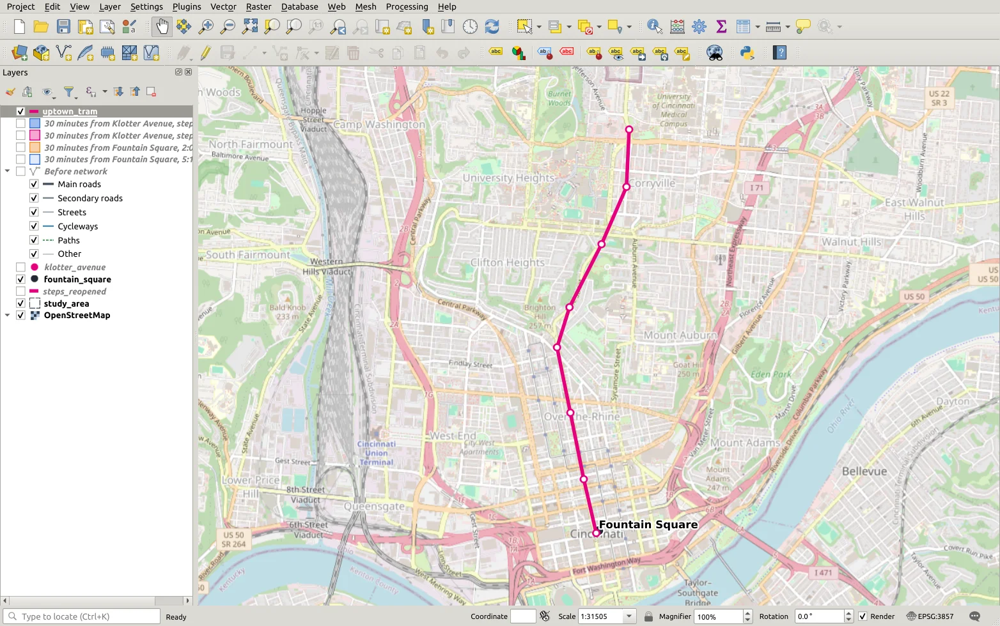

So R5 doesn't follow the drawn path between stops, instead it takes the straight
line from stop to stop at the speed you give. So don't add vertices for
bends (each would become a stop), and give a speed a little under the
real one.

### Build the scenario

Open **Build scenario** (under **Scenarios**):

| Setting | Value | Why |
| --- | --- | --- |
| **New lines** | `uptown_tram` | |
| **Line name field** | `name` | |
| **New line mode** | `TRAM` | |
| **New line speed** | `18` km/h | Easy-R5's guide for a tram in a city, between stops in a straight line |
| **New line headway** | `10` minutes | Every 10 minutes |
| **Service start / end** | `05:00` / `23:00` | All day so it runs at 2:00 pm |
| **Scenario file** | A file of your own, e.g. `uptown-tram.json` | |

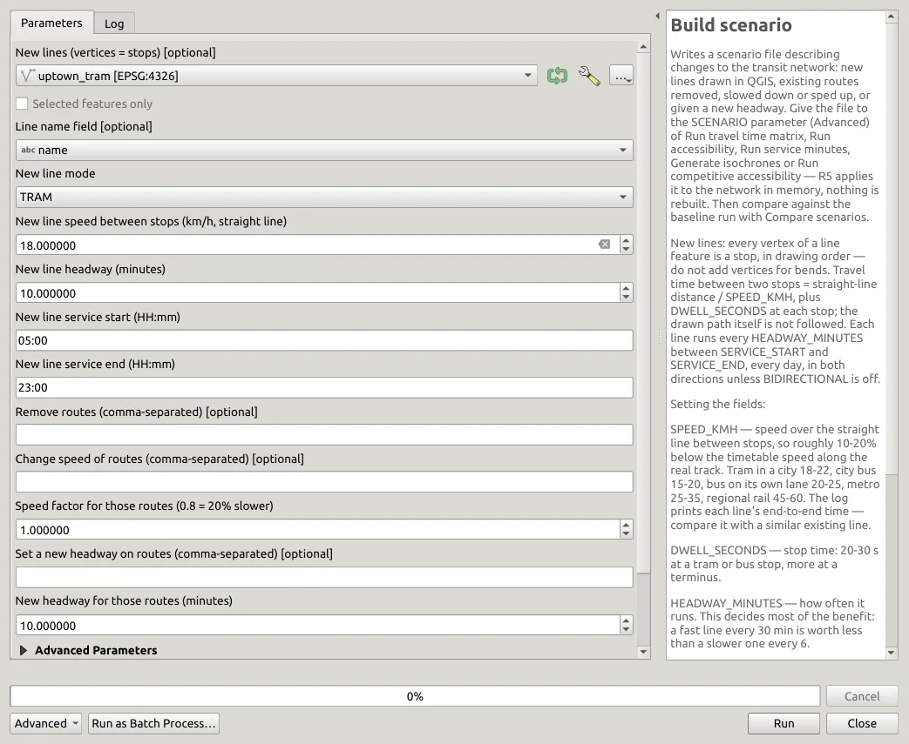

Click **Run**. The log says how long the line takes end to end: 13.6
minutes for the 4.1 km. You can compare that with a similar line you know to
check the speed is sensible.

### The result

The new line has a frequency ("every 10 minutes") but no timetable. R5
doesn't know when the first tram leaves so it tries random departure
times for it. If for example leaving at exactly 2:00 pm the answer then
depends on luck; run it twice and you get two different areas but over a
**departure window** the luck evens out, so compare the two over the
hour from 2:00 to 3:00 pm, taking the middle (median) trip of each
minute (this is how Conveyal and most planners measure).

Run **Generate isochrones** twice, both with Fountain Square, the
`network.dat` of `before.osm.pbf`, departure `14:00` and **Departure
window** `60`:

1.  **Today:** as it is.

2.  **With the tram:** open **Advanced Parameters** and give it the
    scenario file in **Scenario file (from Build scenario)**:

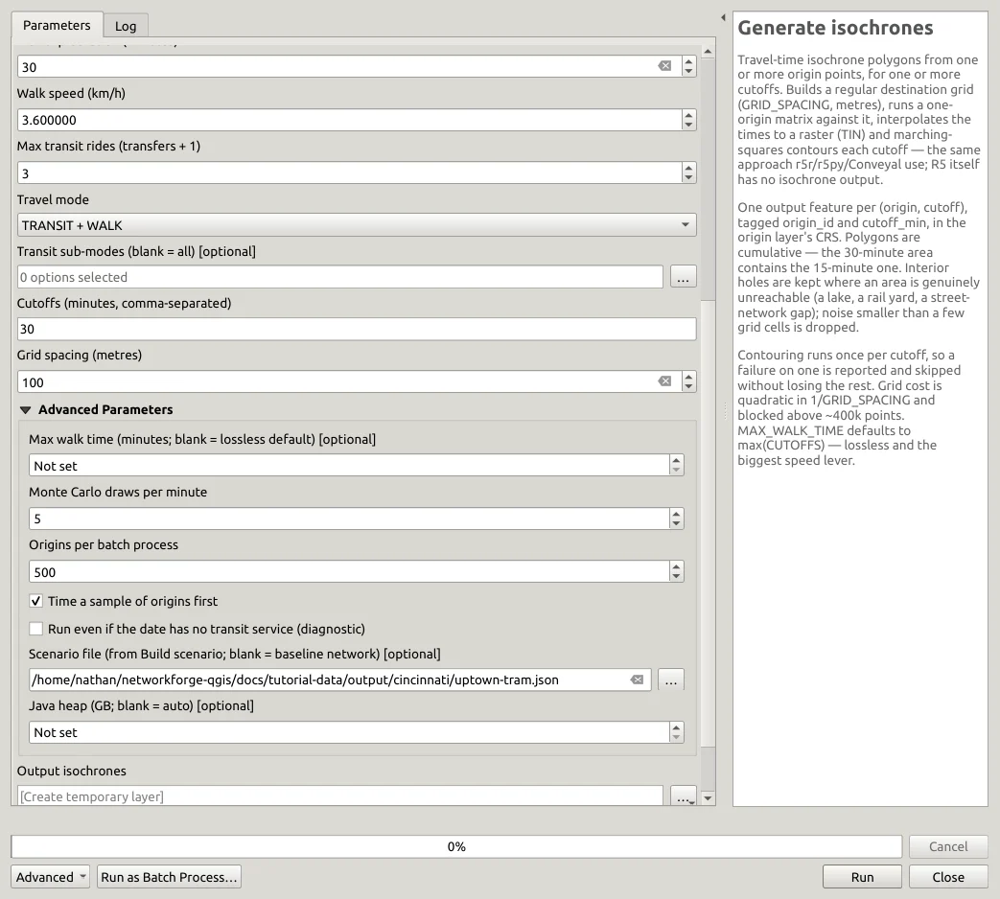

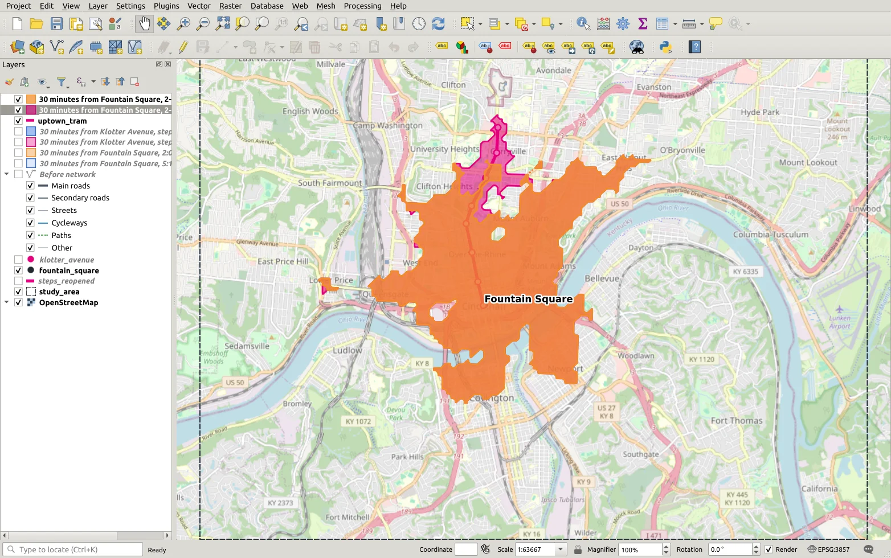

Without any change to what already exists, 30 minutes from Fountain Square in the afternoon covers
**13.9 km2**. Bear in mind that's more than step 6's 10.5 km2, which was for one
departure minute only; over the hour some departures will connect better.
With the tram it covers an improved **15.1 km2**. Nearly all this extra area is at the top of the hill, around the upper stops where the tram can get in time and still leave room for walking. The rest of the area's unchanged as the existing services already serve it.

> To test the opposite, try removing a route instead - put its name, such as
> `33`, in **Remove routes**, and see who loses access. And
> **Compare scenarios** (under **Scenarios**) works out the difference
> for each origin when you run the accessibility tools on many places
> at once.

## 9. What you found

| 30 minutes by transit and on foot, Tuesday 20 October 2026 | Area |
| --- | --- |
| From Fountain Square, leaving 5:15 pm | **11.7 km2** |
| From Fountain Square, leaving 2:00 pm | 10.5 km2 |
| From Klotter Avenue, 5:15 pm, stairways closed (today) | 3.0 km2 |
| From Klotter Avenue, 5:15 pm, stairways reopened | **5.9 km2** |
| From Fountain Square, 2:00-3:00 pm, today | 13.9 km2 |
| From Fountain Square, 2:00-3:00 pm, with the tram | **15.1 km2** |

### What you can't do yet

- **A wheelchair travel mode.** Easy-R5 has no wheelchair setting, and
    R5's analysis ignores the GTFS fields that say which stops and
    trips are step-free.

## Where to go next

- Easy-R5 does a lot more than isochrones: travel-time matrices,
    how many jobs or schools people can reach, comparing scenarios with
    new or faster bus routes. See its
    [README](https://github.com/GISBoost/easy-R5).
- [The first tutorial](tutorial.md): a new road bridge, changes to
    existing streets, and routes before and after.
