# Build a routable network in QGIS: getting to work over a new bridge

This tutorial shows you how to build new and modify existing routable street network in QGIS, for free. It will answer a couple planning questions that will hopefully make it easier to understand how you can use the tools required, and even some simple routing to prove that it all works.

**Problem 1:** Hanna lives in Caversham Park Village, north of
the Thames in Reading (A), and works at Thames Valley Park, a business park
just across the river (B).

The nearest bridge to get across is Sonning Bridge in the east, which is a bit of a detour. For a while locals have been talking about a third bridge east of Reading. Lets quickly see how much of a difference it would make to Hanna's commute.

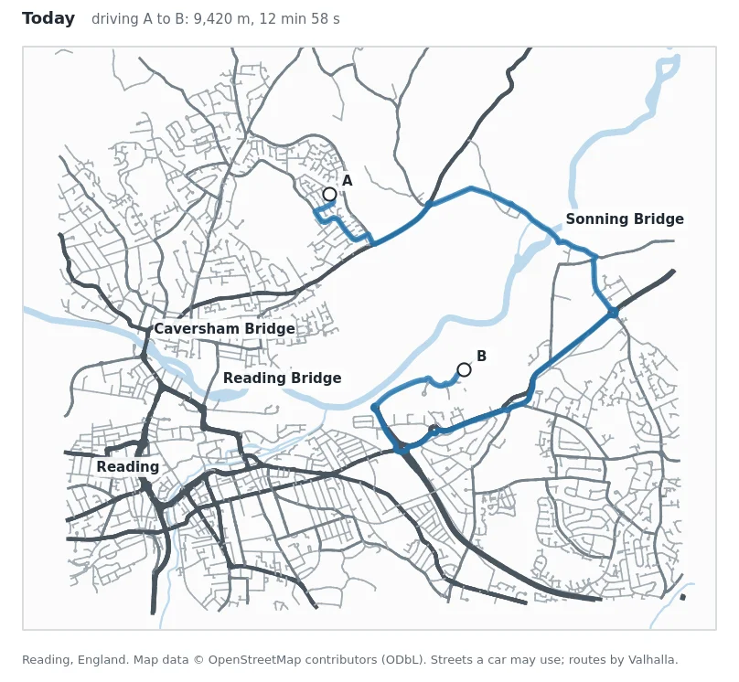

| | |
| --- | --- |
| **You will make** | A street network of east Reading, before and after a new bridge, as layers in QGIS and as OSM PBF files a router can read |
| **You will find out** | How much shorter the drive, the ride and the walk to work become, and what else has to change for traffic to use the bridge |
| **You need** | QGIS 3.34 or newer, and an internet connection |
| **You don't need** | A license, an account, a server, or another program |
| **Tools** | **The NetworkForge** and **Network Analyst** QGIS plugins. |

> The bridge in this tutorial is an invented line, not the official
> design, and the other changes are made up for the example. The streets
> are real though: they come from OpenStreetMap. Map data © OpenStreetMap
> contributors (ODbL).

**Contents**

1.  [Get the plugins and the data](#1-get-the-plugins-and-the-data)
2.  [Open a map](#2-open-a-map)
3.  [Look at the line you will add](#3-look-at-the-line-you-will-add)
4.  [Build the network](#4-build-the-network)
5.  [Look at the result](#5-look-at-the-result)
6.  [Costs, restrictions, travel modes: what you don't have to set up](#6-costs-restrictions-travel-modes)
7.  [Route on it with the Network Analyst plugin](#7-route-on-it-with-the-network-analyst-plugin)
8.  [Stage 2: change existing streets](#8-stage-2-change-existing-streets)
9.  [Stage 3: close a street to cars](#9-stage-3-close-a-street-to-cars)
10. [What you found](#10-what-you-found)

* * *

## 1. Get the plugins and the data

### NetworkForge

1.  In QGIS, open **Plugins > Manage and Install Plugins > Settings**.
2.  Tick **Show also Experimental Plugins**.
3.  Under **Plugin Repositories** click **Add**, name it `NetworkForge`,
    paste this URL and click **OK**:

    ```
    https://github.com/Yibbzz/networkforge-qgis/releases/latest/download/plugins.xml
    ```

4.  On the **All** tab, search for **NetworkForge** and click
    **Install Plugin**.

Open **Processing > Toolbox** and type `NetworkForge` in its search box.
You should see four tools:

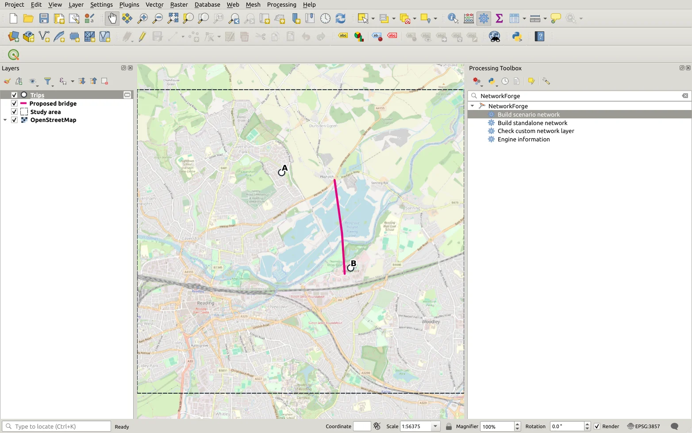

The first time you run one of them, NetworkForge installs its engine
into your QGIS profile which takes a couple minutes and only happens on the first run.

### The Network Analyst plugin

1.  In **Plugins > Manage and Install Plugins**, search the **All** tab
    for **Network Analyst** (by routing.earth) and install it. Its
    routing panel should open on the right.
2.  It needs `pyvalhalla`, the routing engine that runs on your
    computer. Open its settings with the the blank button just right of the green start button on the
    **Local Server** row.
3.  In the **Dependencies** table, click the install button on the
    `pyvalhalla` and routing earth utilities row. It will install them and show a version number when done. Now you are ready to route with your local data!

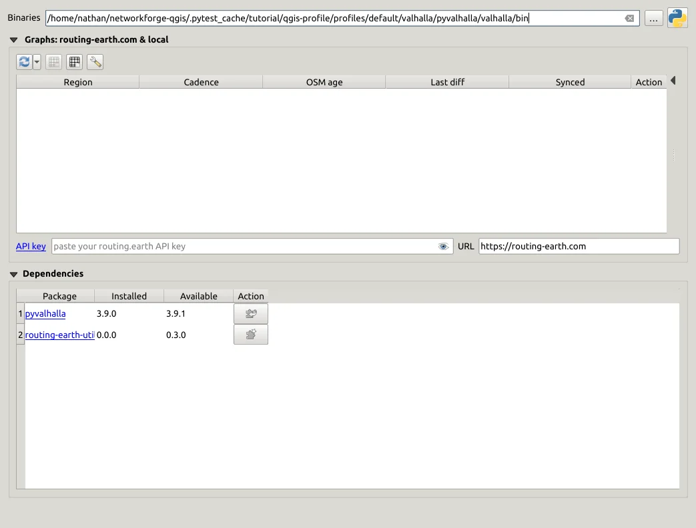

You can leave this window for now: you'll have to come back to it to load your
network in step 7.

### The data

You can digitise your data on QGIS or import whatever geometry you'd like. However if you want things to connect, like to existing street networks or your own lines then you have to follow some rules:

A custom line joins every street it crosses **at the same level**. It doesn't join when either side is a `motorway` or `motorway_link` a bridge or tunnel or on a different `layer`. A line that **ends** on a motorway, bridge or tunnel still joins it and that's how you add a new slip road.

It is really easy to add new roads, cyclepaths, paths etc. But you can get really into detail if you need to. If your custom data does not connect to the existing OpenStreetMap network, the tool will tell you what features are not connecting and do its best to say why. For the full rules please see the NetworkForge engine documentation <https://github.com/Yibbzz/networkforge/blob/main/docs/network-rules.md>

But for this example there is some ready-made data in the tutorial called [reading-bridge.gpkg](tutorial-data/reading-bridge.gpkg) you can use to follow along.

The contents within are:

| Layer | What it is |
| --- | --- |
| `study_area` | The rectangle to build the network for, about 40 km2 of east Reading |
| `trips` | Four places: A home, B work, C Earley, D Sonning Eye |
| `1_bridge` | The new bridge: one line |
| `2_bridge_and_park_road` | The bridge, plus changes to the business park's road (step 8) |
| `2_barriers_removed` | Two points that take out the park's security barriers (step 8) |
| `3_barriers_removed_and_bollard` | The same two points, plus a bollard on Sonning Bridge (step 9) |

Because the study area we're looking at is only 40 km2 the NetworkForge plugin fetches the OpenStreetMap data automatically based off the study_area polygon.

Anything that is over 1,000 km2 you'll have to download an OpenStreetMap file yourself. On how to do that look at the end of [step 4](#larger-areas-a-downloaded-openstreetmap-file).

## 2. Open a map

1.  Start a new project (**Project > New**).
2.  Add a background map: in the **Browser** panel, open **XYZ Tiles**
    and double-click **OpenStreetMap**.
3.  Drag `reading-bridge.gpkg` onto the map, and pick the layers
    `study_area`, `1_bridge` and `trips`.
4.  Right-click `study_area` and choose **Zoom to Layer(s)**.

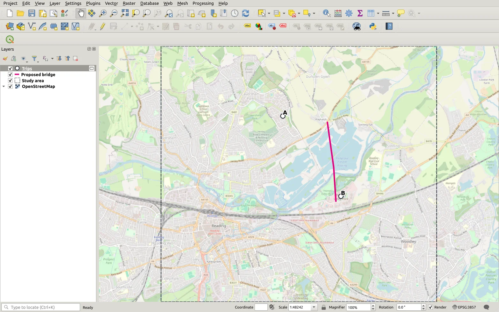

A is the home and B the office. The pink line runs from the roundabout
on the A4155 at Playhatch, over the meadows and the river, to the
roundabout at the entrance of Thames Valley Park.

## 3. Look at the line you will add

A routable network needs to know, for every street, how fast it is, who
may use it, which way, and where it crosses others without joining
them. The existing streets come from OpenStreetMap with all of that
already recorded, so you only have to look at your change. Right-click `1_bridge` on the layer panel and
choose **Open Attribute Table**:

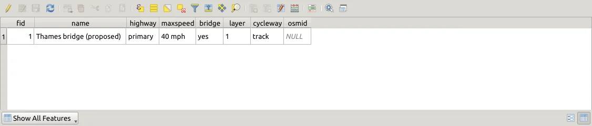

You can see each field is a standard OpenStreetMap tag:

| Field | Value | What it says |
| --- | --- | --- |
| `name` | Thames bridge (proposed) | Used in turn-by-turn directions |
| `highway` | `primary` | The kind of road: sets who may use it, its default speed and its place in the road hierarchy |
| `maxspeed` | `40 mph` | The speed limit, which sets the driving time |
| `bridge` | `yes` | It is a bridge............. |
| `layer` | `1` | ...above the ground, so it doesn't join the paths and streets it passes over |
| `cycleway` | `track` | A cycle track beside the road, apart from the traffic |
| `osmid` | empty | Only used when changing an existing street (step 8) |

Two things make this line join the network where it should and nowhere
else:

- **Its ends sit on the two roundabouts.** A line joins the street it
    ends on, and any street it crosses on the same level.
- **`bridge` = `yes` and `layer` = `1`.** The bridge crosses the Thames
    Path and other paths on the way, and those crossings must not become attached to the bridge for obvious reasons

To draw your own line, make a line layer in QGIS (**Layer > Create
Layer > New GeoPackage Layer**), add text fields with these names, and
draw it with snapping on (important!), so the ends land on the streets. If it ends too far from the connecting end street it will not connect.

## 4. Build the network

In the Processing Toolbox, double-click **Build scenario network** and
fill in the form:

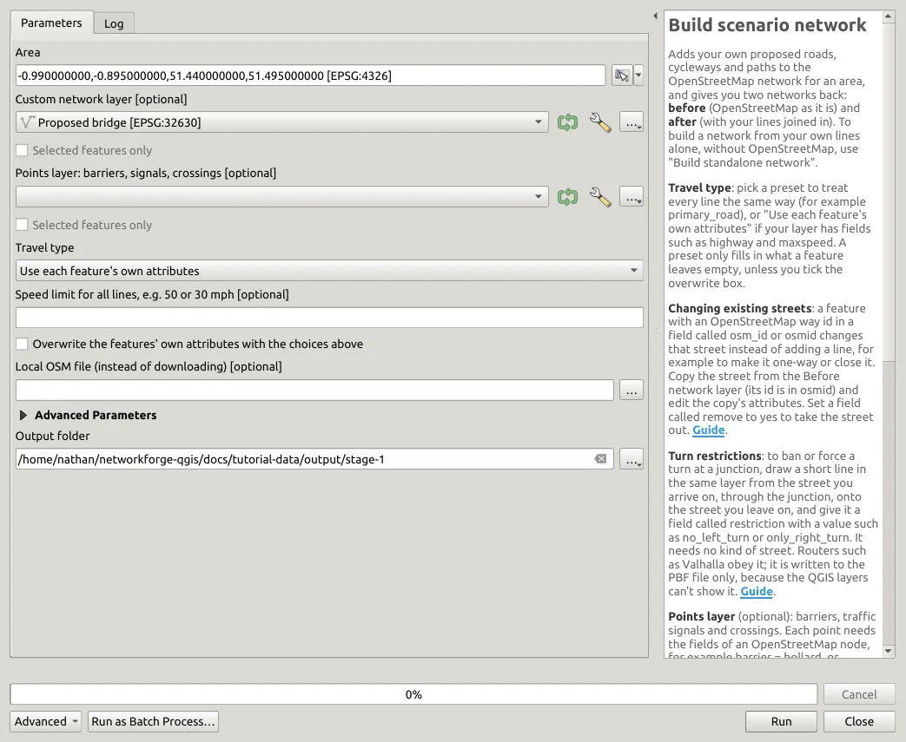

| Setting | Value |
| --- | --- |
| **Area** | Click the button at the right of the box, choose **Calculate from Layer**, and pick `study_area` |
| **Custom network layer** | `1_bridge` |
| **Points layer** | Leave empty for now |
| **Travel type** | **Use each feature's own attributes** (the line already says it's a primary road) |
| **Output folder** | A new, empty folder of your own |

Click **Run**. NetworkForge downloads the streets of the area from
OpenStreetMap, joins your line into them, checks the result, and writes
the files. You can look at the log to see what's going on:

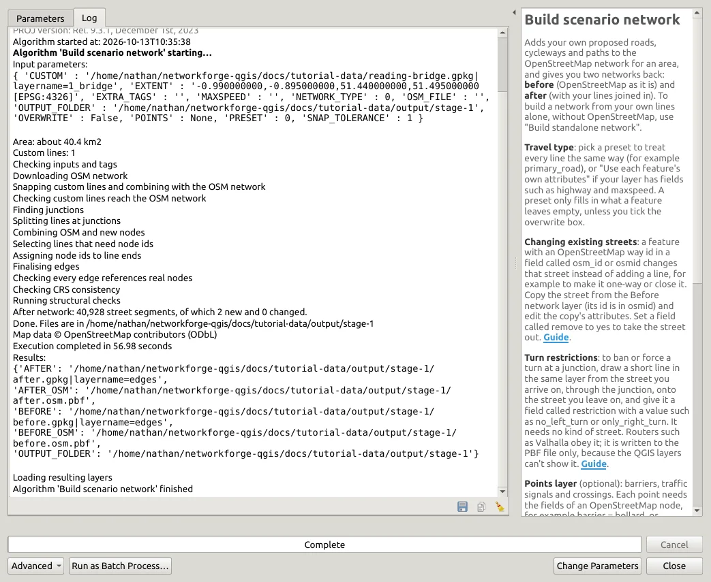

"After network: 40,928 street segments, of which 2 new and 0 changed" means the
bridge was joined into the streets! Had the line missed them, the log
would shout at you and the line would be selected on the map for you to inspect.

The output folder now holds:

| File | What it is for |
| --- | --- |
| `before.osm.pbf`, `after.osm.pbf` | **The networks.** OpenStreetMap files, without and with your change, for routers such as Valhalla. These are what you route on |
| `before.gpkg`, `after.gpkg` | A preview of the same networks for QGIS, loaded as layers |

### Larger areas: a downloaded OpenStreetMap file

The streets came from OpenStreetMap's Overpass service, which is run by
volunteers and shared by everyone, we don't want to overload it so NetworkForge only downloads areas up
to **1,000 km2** from it.

For larger areas you need to download data yourself, but it has the benefit of making
repeat builds a lot faster and keeps every build on exactly the same data. So I recommend doing it.

**1.** Here are two free sources:

- **[Geofabrik](https://download.geofabrik.de)** has ready-made files
    for continents, countries and regions, updated daily. Click down
    through the regions until you reach one that covers your area, and
    download its **`.osm.pbf`** file.
- **[BBBike extracts](https://extract.bbbike.org)** lets you draw your
    own rectangle on a map. Choose the format **Protocolbuffer (PBF)**,
    give your email address, and you get a download link a few minutes
    later. Use it when your area crosses the edge of the regions Geofabrik
    offers (important to check!)

**2.** Now Give it to the tool. In **Build scenario network**, pick the file
in **Local OSM file (instead of downloading)**. Everything else stays
the same.

Bare in mind very large areas need a lot of ram (memory): building 600 km2 of Luxembourg
takes about 3.5 GB.

## 5. Look at the result

The tool loaded two layers, **Before network** and **After network**,
coloured by kind of street. The bridge should be drawn in pink in the After
network:

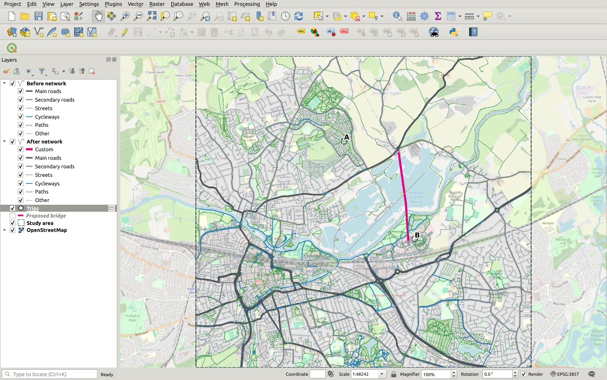

You can open the after network's attribute table to inspect the streets to verify it worked, the bridge row should have a `custom` = `yes` attribute.

Now bare in mind this data is NOT what the routing engine will use, it is a 'simplified' Geopackage representation of the network you can use to view within QGIS. The PBF file that was saved in the same directory knows a lot more things, like how the bridge has a cycle track, existing barriers, surfaces, vehicle sizes, turn restrictions etc.etc.

## 6. Costs, restrictions, travel modes

To do routing on a network you need costs, rules and travel modes. The router we are going to use (Valhalla) already has set defaults, and so does the OpenStreetMap data.

| What a router needs | Where it comes from |
| --- | --- |
| **Distance and travel time** | Valhalla measures distance from the geometry and works out time from `highway` and `maxspeed`, and adds a delay for each turn |
| **Who may go where**: cars, buses, walking, unpaved roads, one-way streets, height limits | OpenStreetMap tags on the streets: `motor_vehicle`, `bus`, `foot`, `surface`, `oneway`, `maxheight`. All the existing streets will have these and you can add them to your data |
| **A road hierarchy**, so long trips keep to main roads | The `highway` class provides this |
| **Travel modes** | You can choose this when you route: car, bus, lorry, motorbike, bicycle, on foot. |
| **Directions** | The routing engine (Valhalla) writes them from `name` |

## 7. Route on it with the Network Analyst plugin

### Load the two networks

The Network Analyst plugin requires a PBF file to build a routable network. To add the PBF file that has just been created:

1.  Open its settings again from step 1.
2.  In the **Graphs** box, click the small arrow beside the first
    button (refresh arrows) and choose **From PBF** (under "Advanced").
3.  **Name** it `reading-before` and pick `before.osm.pbf` from your
    output folder and press **OK**.

    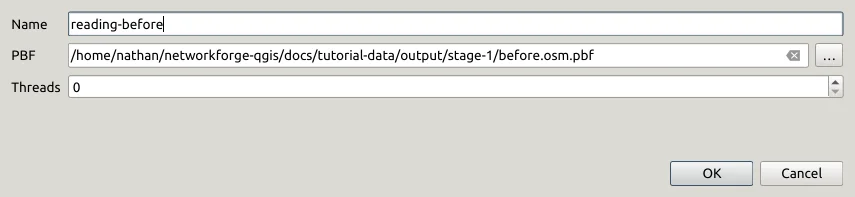
4.  It will take a min, and when you see "Building tiles succeeded" you can do the same for `after.osm.pbf`, named
    `reading-after`.

Both graphs will now be in the list:

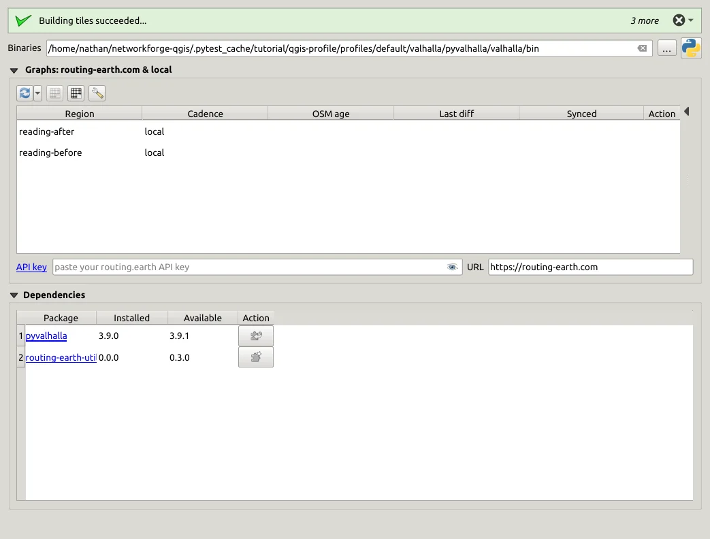

### Quickly route from home to work

In the Network Analyst panel:

1.  **Provider**: `localhost`.
2.  **Local Server**: pick `reading-before` and click the start button.
    It turns into a red stop button while the it runs.
3.  **Profile**: click the car.
4.  **Waypoints**: either click the green **+**, then click on the map at A and
    at B. Or add from layer - Trips
5.  Click **Execute**.

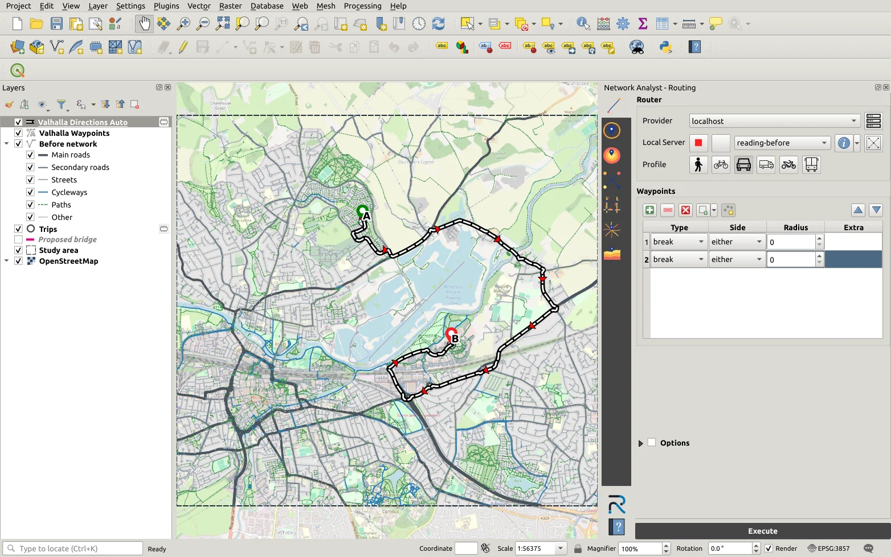

The route goes east to Sonning Bridge and back west to the park: 9.4 km,
**12 min 58 s**. The plugin adds the route as a layer, with its
`distance` (metres) and `duration` (seconds) in the attributes.

### The same trip with the new bridge

1.  Click the red stop button.
2.  Pick `reading-after` and start the server again.
3.  Hide the old route layer and click **Execute**.

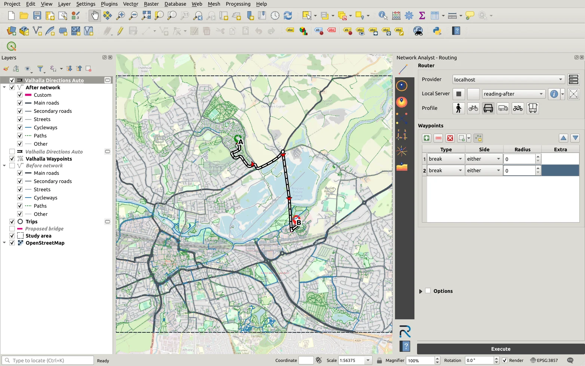

4.1 km, **4 min 49 s**: eight minutes saved each way. Try the bicycle and
walking profiles too, with the same waypoints:

| A to B | Today | With the bridge |
| --- | --- | --- |
| Driving | 9.4 km, 12 min 58 s | 4.1 km, **4 min 49 s** |
| Cycling | 7.3 km, 25 min 33 s | 3.7 km, **12 min 33 s** |
| Walking | 6.4 km, 75 min 36 s | 3.6 km, **42 min 45 s** |

It routes across the new bridge, and the new route is much faster!

## 8. Stage 2: change existing streets

### The problem

Now that's great if we only want to get to the business park, but try and route anything beyond it and you'll see the routing engine always prefers Sonning bridge in the east. Why is this? Try waypoints now at home (A) to Earley (C) south of the railway.

The reason is becuase of what's already in OpenStreetMap. The bridge lands on
the business park's own road which has:

- a **security barrier** on each carriageway
    which routers avoid sending through traffic past;
- a **15 mph** speed limit.

A network is only as good as what the existing streets say, and adding
a road isn't always enough. An actual scheme would rebuild this road as a
public one. So lets try and change it!

### Changing existing streets and points

NetworkForge can change a street that is already in OpenStreetMap. A
feature in your layer that carries the street's OpenStreetMap way id
changes that street on the stretch it lies along instead of adding a
line:

1.  Select the stretches of the park's road in the **Before network**
    layer and copy them into your own layer (**Edit > Copy Features**,
    then **Edit > Paste Features** into a layer being edited). Their way
    ids will come with them in the `osmid` field.
2.  Set `maxspeed` to `30 mph` on the copies. Leave the other fields
    empty: only what differs from OpenStreetMap is changed.

Barriers are points so they have to go in a second point
layer given to the tool's **Points layer** setting:

3.  Create a point layer and add a point exactly on each barrier (snapping helps), with a field `remove_tags` =
    `barrier`. That will delete the tag from the existing node, removing the barrier. (To see where the barriers are, add the
    `nodes` layer from `before.gpkg` and look for a value in its
    `barrier` column.)

The data file already has both ready: `2_bridge_and_park_road` (the bridge and
39 stretches of the park road) and `2_barriers_removed` (two points).

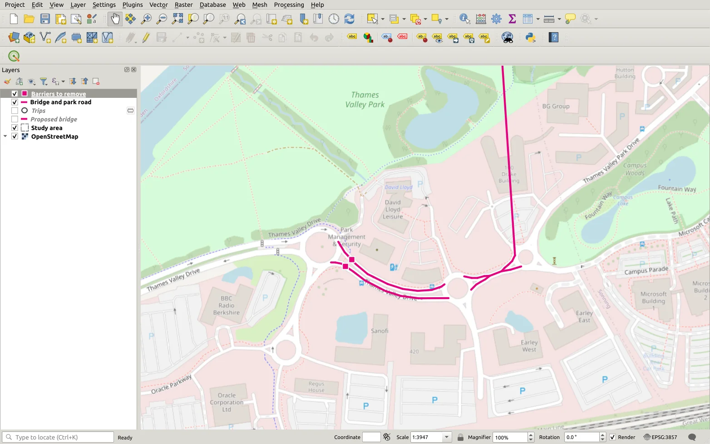

Run **Build scenario network** again in the NetworkForge tool with **Custom network layer** =
`2_bridge_and_park_road`, **Points layer** = `2_barriers_removed`, and a
new output folder. After processing, the changed streets should be drawn in orange in the After
network so you can see whats changed:

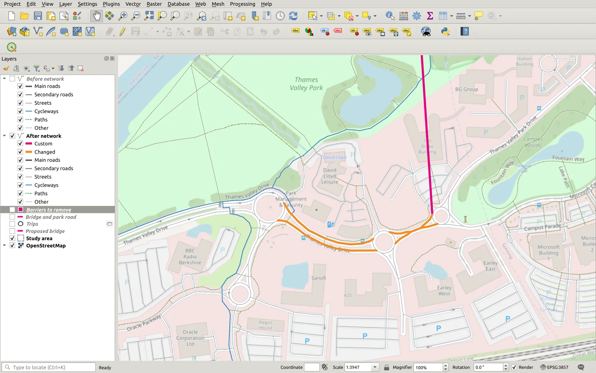

Now you can build a graph from the new `after.osm.pbf` using the Network Analyst plugin and route from A to C again.
The new route should come to around **9 min 20 s**, over the new bridge and through the park. Cars can now go though!

## 9. Stage 3: close a street to cars

With a new bridge to take the traffic, the narrow old Sonning bridge may be better off only serving cyclists and walkers. Lets see what that would look like. By adding another bollard! Add a point in the middle of Sonning Bridge with a field `barrier` = `bollard`. A point that isn't on a
junction cuts the street there and puts the bollard on it. The layer
`3_barriers_removed_and_bollard` has it within stage 2's two points:

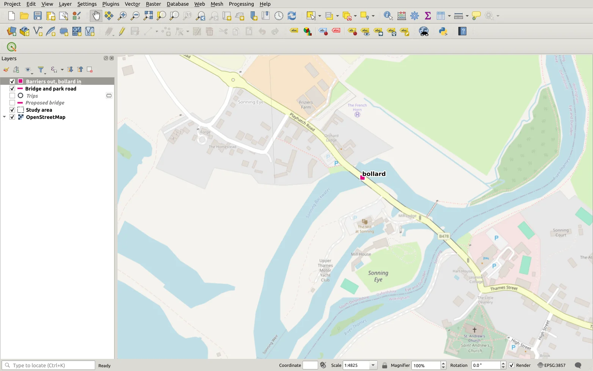

Build the network again with **Points layer this time being** = `3_barriers_removed_and_bollard`.

Lets route from Sonning Eye (D) to
Earley (C) on the stage 2 graph after network.

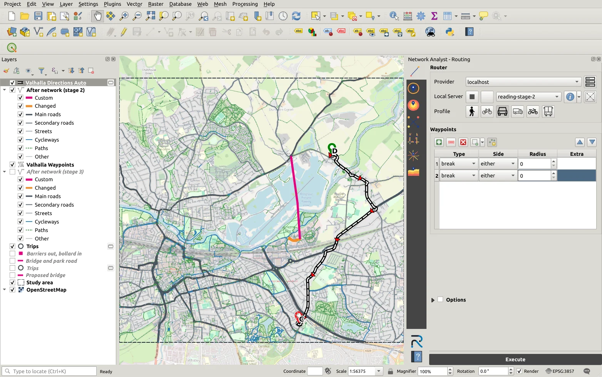

That took 5.5 km **9 min 16 s** over Sonning Bridge. Then the same route on a graph of the
stage 3 network:

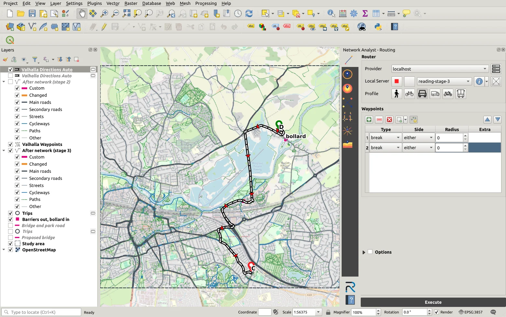

It has increased to 7.0 km, **10 min 34 s** because the car turns back from the bollard and goes
over the new bridge instead. If you switch to the bicycle profile or walking you'll see ride is unchanged as bicycles and walkers go past the bollard.

That is a trade-off, and seeing both is the point of
building the network before deciding.

## 10. What you found

| Trip | Today | Stage 1: bridge | Stage 2: park road opened | Stage 3: bollard at Sonning |
| --- | --- | --- | --- | --- |
| A to B, home to work, driving | 12 min 58 s | **4 min 49 s** | 4 min 49 s | 4 min 49 s |
| A to B, cycling | 25 min 33 s | **12 min 33 s** | 12 min 33 s | 12 min 33 s |
| A to B, walking | 75 min 36 s | **42 min 45 s** | 42 min 45 s | 42 min 45 s |
| A to C, past the park, driving | 11 min 23 s | 11 min 23 s | **9 min 20 s** | 9 min 20 s |
| D to C, from Sonning, driving | 9 min 16 s | 9 min 16 s | 9 min 16 s | **10 min 34 s** |
| D to C, cycling | 19 min 48 s | 19 min 48 s | 19 min 48 s | 19 min 48 s |

Along the way you used most of what NetworkForge does: a new line with
a bridge, a layer and a cycle track, changed existing streets, points
that remove a tag and add a barrier, before and after networks, and
routes on both with the Network Analyst plugin.

## Where to go next

- [Examples](examples.md): a closed street, a one-way street, a banned
    turn, a bollard, a network of your own lines.
- [What people use it for](use-cases.md).
- Questions and problems:
    [NetworkForge issues on GitHub](https://github.com/Yibbzz/networkforge-qgis/issues).
